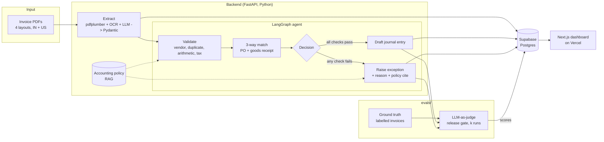

# LedgerPilot

**A GenAI invoice-to-ledger agent for Record-to-Report (R2R) and Accounts Payable automation.**

LedgerPilot reads supplier invoices (PDF), extracts structured fields with an LLM, validates them against
an accounting policy, runs a three-way match (invoice vs purchase order vs goods receipt), and then either
drafts a journal entry or raises an exception with a cited reason. An evaluation harness with an
LLM-as-judge release gate decides whether the agent's decisions are trustworthy enough to approve.

It is a portfolio project modelled on the finance-operations + agentic-AI work large business-process
companies (for example Genpact) do for their clients. **All data in this repo is synthetic and fictional.**

> Status: **Day 1 of 5 complete** - repo scaffold, synthetic invoice dataset, sample AP policy.

## Why this problem

AP teams spend most of their time on the same loop: read the invoice, check it, match it, chase the exceptions.
It is high-volume, rule-heavy and auditable, which makes it a good fit for an agent, provided the agent is
measured honestly. The project is as much about the **evaluation** (accuracy numbers, consistency across
repeated runs, a release gate) as about the extraction.

## Architecture



## Repo layout

| Path | What it holds |
|------|---------------|
| `backend/` | FastAPI app (`app/main.py`), agent + extraction code arrives Day 2-3 |
| `frontend/` | Next.js + TypeScript dashboard (placeholder page until Day 5) |
| `data/` | Synthetic data generator, invoice PDFs, PO / GRN / vendor CSVs, ground truth |
| `evals/` | Evaluation harness (Day 4) |
| `docs/` | Sample accounting policy used for RAG (`accounting_policy.md`) |

## Synthetic dataset (Day 1)

`python data/generate.py` is seeded (`--seed 42`) and reproducible: two runs produce byte-identical files.

- **40 invoice PDFs** in `data/invoices/` across **4 visual templates** (classic grid, modern banded, monospace
  minimal, compact card list). Each template varies labels (`Invoice No.` / `Document no` / `INV No.:`),
  date formats and where the total sits. Indian vendors (GST: CGST+SGST or IGST, INR with lakh grouping)
  and US vendors (state sales tax, USD).
- **32 clean** and **8 exceptions (20%)**, one fault per invoice: `total_mismatch` x2, `price_mismatch` x2,
  `wrong_tax`, `missing_po`, `duplicate_invoice`, `unknown_vendor`. Two clean invoices are billed +1% vs the PO
  (inside tolerance) and two are partial deliveries, to test that the agent does not over-flag.
- `data/purchase_orders.csv`, `data/goods_receipts.csv`, `data/vendors.csv`: the reference data for the match.
- `data/ground_truth.json`: for every invoice, the fields as **printed** plus the expected outcome
  (`approve` with an approval tier, or the exception type and a human-readable reason).
- `python data/verify.py` checks that every PDF parses with pdfplumber and contains the ground-truth fields, and
  that a small rule-based oracle implementing `docs/accounting_policy.md` reproduces all 40 expected outcomes.

## Quick start

```bash
python3 -m venv .venv && source .venv/bin/activate
pip install -r backend/requirements.txt -r data/requirements.txt

# regenerate + verify the dataset
python data/generate.py
python data/verify.py

# run the API
cp .env.example .env            # fill in keys later; none are needed for /health
cd backend && uvicorn app.main:app --reload
curl http://localhost:8000/health

# frontend placeholder
cd frontend && npm install && npm run dev
```

## 5-day roadmap

| Day | Focus | Deliverable |
|-----|-------|-------------|
| 1 | **Data and setup** (done) | Monorepo, synthetic invoices + PO/GRN/vendor data, ground truth, sample AP policy, health endpoint |
| 2 | **Extraction** | `pdfplumber` text + OCR fallback; LLM extracts vendor, invoice number, dates, line items, tax, total into a Pydantic schema; results stored in Supabase |
| 3 | **The agent** | LangGraph flow: extract -> validate -> PO/GRN match -> journal entry or exception; RAG over `docs/accounting_policy.md` so every decision cites a policy section |
| 4 | **Evaluation** | Hand-verify 20 labelled invoices; field accuracy and outcome accuracy; LLM-as-judge release gate with a confidence threshold, run k times to show consistency (pass^k); full logging |
| 5 | **Dashboard and polish** | Next.js dashboard (upload queue, extracted fields, exceptions, eval scores) deployed on Vercel; README with accuracy numbers and diagram; LinkedIn write-up |

## Tech stack

FastAPI, Pydantic, pdfplumber, LangGraph, LangChain, Supabase (Postgres + RLS), Next.js + TypeScript, Vercel.
LLM provider is pluggable (Groq / Gemini free tier, or Azure OpenAI) via `.env`.

## Disclaimer

Sample project. Companies, people, tax IDs, bank details and the accounting policy are fictional and are not
tax or accounting advice.
